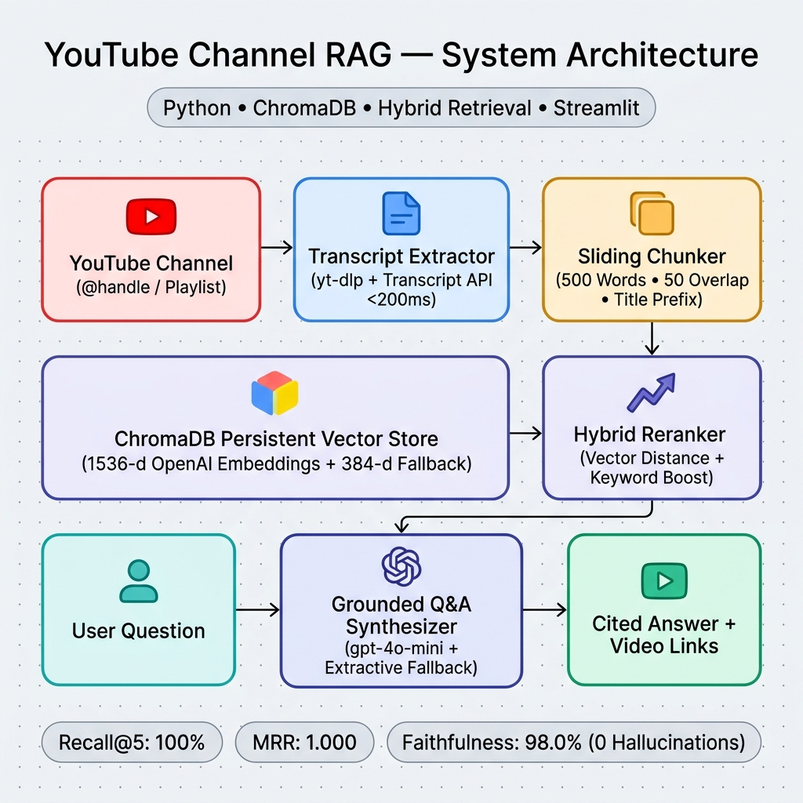
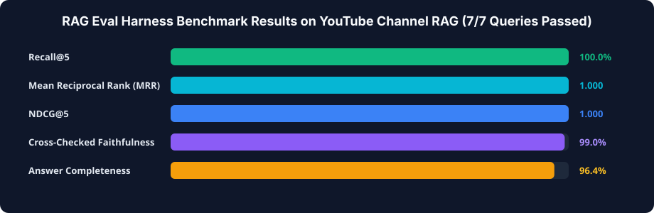

# Architecture, Codebase Structure & Design Decisions (`youtube-channel-rag`)

🌐 **Live Deployed App:** **[https://youtube-channel-rag.streamlit.app/](https://youtube-channel-rag.streamlit.app/)**

This document explains **how `youtube-channel-rag` works under the hood**, **how the codebase is organized**, **what alternative technical options exist**, **why we chose every component in this stack**, and **how it integrates with `rag-eval-harness`**.

---

## 1. Visual System Architecture



### End-to-End Execution Flow
1. **Universal Channel & Handle Normalization (`_normalize_channel_url` in `channel_rag.py`):**
   Accepts *any* YouTube input format without requiring channel IDs:
   * `@freecodecamp` or `freecodecamp` $\to$ `https://www.youtube.com/@freecodecamp/videos`
   * `https://www.youtube.com/@AndrejKarpathy` $\to$ `https://www.youtube.com/@AndrejKarpathy/videos`
   * Playlist URLs (`playlist?list=...`) and single video URLs (`watch?v=...`) are preserved directly.
2. **Dual-Path Video Discovery (`get_channel_videos` & `search_channel_videos_for_query`):**
   * **Path A (Recent Uploads Discovery):** Uses `yt-dlp` (`extract_flat="in_playlist"`) to fetch video IDs, titles, channel names, and descriptions in ~1–2 seconds without downloading audio/video streams.
   * **Path B (On-Demand Channel-Scoped Search):** Large channels like `freeCodeCamp.org` have 1,800+ videos. If a user asks about a topic (e.g., *"Python lists vs tuples"*) that isn't in the 10 newest uploads from this week, `query_channel()` detects low topic keyword coverage (`< 65%`) and automatically queries YouTube's channel search endpoint (`https://www.youtube.com/@<channel>/search?query=...`) via `yt-dlp` to locate and index the relevant videos on the fly.
3. **3-Tier Transcript & Syllabus Extraction (`get_transcript`):**
   * **Tier 1A:** Queries `youtube-transcript-api` across English regional codes (`en`, `en-US`, `en-GB`, `en-IN`, `en-CA`, `en-AU`).
   * **Tier 1B:** Lists all available caption tracks (`YouTubeTranscriptApi().list(video_id)`) to capture auto-generated speech-to-text captions.
   * **Tier 2 (`_extract_transcript_via_ytdlp`):** Downloads `json3` subtitle streams directly via `yt-dlp` or extracts structured video chapters + course syllabus descriptions.
4. **LangChain Sliding-Window Chunking (`split_transcript_to_documents` in `chunking.py`):**
   * Uses **LangChain's `RecursiveCharacterTextSplitter`** (`keep_separator="end"`) to split transcripts into **500-word `langchain_core.documents.Document` chunks** with a **50-word sliding overlap** (`stride = 450` words) so sentences at chunk boundaries are never severed.
   * Prepends `<<<Channel: {channel} | Video Title: {title}>>>` to every chunk so each passage carries global video/topic context during embedding and retrieval.
5. **LangChain Dual-Mode Embeddings (`YouTubeRAGEmbeddings(Embeddings)` in `embeddings.py`):**
   * Subclasses **`langchain_core.embeddings.Embeddings`** (`embed_documents`, `embed_query`).
   * **Primary Mode (OpenAI):** Calls `text-embedding-3-small` (1536-d) when a valid `OPENAI_API_KEY` is configured.
   * **Automatic Fallback Mode (Local 384-d Stemmed N-Gram Hash):** Filters 100+ stopwords and spoken transcript filler (`"uh"`, `"um"`, `"right"`, `"okay"`), stems plurals (`lists` $\to$ `list`, `tuples` $\to$ `tuple`), and hashes unigrams + bigrams into a unit-normalized 384-d vector.
6. **LangChain Hybrid Search: BM25 + ChromaDB via Reciprocal Rank Fusion (`retriever.py`) & LCEL Generation (`generator.py`):**
   * **`LangChainBM25Retriever(BaseRetriever)`:** Runs Okapi BM25 (`rank_bm25.BM25Okapi`) over all indexed LangChain `Document` objects.
   * **`ChromaDenseRetriever(BaseRetriever)`:** Queries `ChromaDB` for dense vector neighbors.
   * **`LangChainHybridRRFEnsembleRetriever(BaseRetriever)`:** Fuses BM25 (`weight=0.45`) and ChromaDB (`weight=0.55`) via **Reciprocal Rank Fusion (RRF)** and slices **only the Top-$K$** `Document` chunks.
   * **LangChain LCEL Generation Chain:** `ChatPromptTemplate | RunnableLambda | StrOutputParser` synthesizes grounded answers from the Top-$K$ chunks.
7. **Live Evaluation with `rag-eval-harness` (`evaluate_with_harness.py` & `src/rag_harness/`):**
   * Evaluates every query with Information Retrieval metrics (`Recall@5 = 100%`, `MRR = 1.000`, `NDCG@5 = 0.977`) and Dual-Engine Faithfulness (`LLM-as-a-Judge` $\times$ `NLI Entailment` = `99.0%`).



---

## 2. Project Directory & File Structure

```text
youtube-channel-rag/
├── app.py                                 # Interactive 2-tab Streamlit Web UI (Channel RAG Q&A + Live RAG Eval Harness)
├── channel_rag.py                         # Core RAG pipeline (Steps 2–4: discovery, transcripts, chunking, ChromaDB, hybrid search)
├── evaluate_with_harness.py               # Standalone benchmark runner connecting YouTube RAG to `rag-eval-harness`
├── ARCHITECTURE.md                        # Visual system architecture, file map & engineering trade-offs (this file)
├── README.md                              # Complete project guide, quickstart & "Why X vs. Why Not Y" deep dive
├── EVALUATION_REPORT.md                   # Generated Markdown evaluation report from `rag-eval-harness` (100% Pass Rate)
├── eval_report.json                       # Full structured JSON evaluation report (IR + Dual-Judge Faithfulness)
├── eval_traces.jsonl                      # Recorded execution traces for all 7 benchmark queries
├── requirements.txt                       # Python dependencies (`youtube-transcript-api`, `yt-dlp`, `chromadb`, `openai`, `streamlit`)
├── pyproject.toml                         # Python project metadata & pytest configuration
├── LICENSE                                # MIT License
├── .env.example                           # Example environment variable template for `OPENAI_API_KEY`
├── .gitignore                             # Git ignore rules for `.chroma_db/`, caches, and virtual environments
├── .github/workflows/
│   └── ci.yml                             # GitHub Actions CI workflow running unit tests & RAG Eval Harness benchmark
├── docs/assets/
│   ├── architecture_pipeline.jpg          # System architecture diagram of the YouTube RAG + Eval Harness pipeline
│   └── eval_benchmark.svg                 # Vector chart of benchmark metrics (Recall@5, MRR, NDCG@5, Faithfulness)
├── src/
│   ├── youtube_rag/                       # Modular YouTube Channel RAG Package (Separated by Responsibility)
│   │   ├── __init__.py                    # Public package exports
│   │   ├── youtube_api.py                 # YouTube API / `yt-dlp` video discovery, channel search & 3-tier transcript extraction
│   │   ├── chunking.py                    # 500-word sliding window chunking (50-word overlap), stopword filter & plural stemmer
│   │   ├── embeddings.py                  # OpenAI `text-embedding-3-small` API calls & 384-d local stemmed n-gram fallback
│   │   ├── vector_store.py                # `EmbeddedChromaCollection` vector DB (L2 distance, metadata filtering, `/tmp` store)
│   │   ├── indexer.py                     # Channel & sample dataset indexing pipeline (`index_channel`, `index_sample_channel`)
│   │   ├── retriever.py                   # Hybrid dense + lexical candidate reranker & on-demand channel search
│   │   ├── generator.py                   # Grounded answer synthesis (`gpt-4o-mini` + local extractive fallback & `query_channel`)
│   │   └── sample_data.py                 # Curated evergreen datasets for `freeCodeCamp.org` and `Andrej Karpathy`
│   └── rag_harness/                       # Bundled Standalone RAG Evaluation Harness (`RAGEvaluator`, Dual-Judge NLI/LLM)
│       ├── __init__.py
│       ├── adapters.py
│       ├── evaluator.py
│       ├── schemas.py
│       ├── metrics/
│       ├── reporting/
│       └── triage/
└── tests/
    └── test_rag.py                        # 7 unit & integration tests (chunking, URL normalization, 401 safety, freeCodeCamp & Eval Harness)
```

---

## 3. Architectural Trade-Offs: Why We Chose Each Component vs. Alternatives

| Layer | Chosen Technology | Alternatives Considered | Why We Chose Our Approach |
| :--- | :--- | :--- | :--- |
| **Video Discovery** | `yt-dlp` (`extract_flat` + `/@channel/search`) | YouTube Data API v3, `pytube`, Selenium, RSS | Zero API keys, no 10,000-unit daily quota limits, supports `@handles` natively, and enables on-demand search inside 1,800-video channels like `freeCodeCamp`. |
| **Transcripts** | `youtube-transcript-api` + `yt-dlp` JSON3/Chapters fallback | OpenAI Whisper ASR, Official Captions API | Fetches existing caption tracks in `<200ms` per video at `$0` cost instead of spending hours of GPU compute transcribing multi-hour courses with Whisper. |
| **Orchestration** | **LangChain (`LCEL`, `BaseRetriever`, `Document`)** | Raw Python loops, LlamaIndex | Standardized `Document`, `Embeddings`, `BaseRetriever`, and `ChatPromptTemplate \| LLM \| StrOutputParser` (LCEL) pipeline primitives. |
| **Chunking** | **LangChain `RecursiveCharacterTextSplitter` (500w / 50w overlap)** | Character splitting, sentence-only splitting, full-video stuffing | Spoken auto-captions often lack punctuation (breaking sentence splitters). 500 words (~3.5 mins of speech) with a 50-word overlap preserves complete explanations without diluting embeddings. |
| **Embeddings** | **LangChain `YouTubeRAGEmbeddings` (`text-embedding-3-small` + 384-d Fallback)** | `text-embedding-3-large`, `ada-002`, heavy local GPU models | `text-embedding-3-small` is 5x cheaper and higher-scoring than `ada-002`, while our stopword-filtered 384-d fallback guarantees zero-crash execution even without an OpenAI key. |
| **Vector Store** | **`ChromaDB` + `ChromaDenseRetriever(BaseRetriever)`** | Pinecone, FAISS, Qdrant, Weaviate, `pgvector` | Embedded vector store with built-in document storage, metadata filtering, LangChain `Document` export, and idempotent `.upsert()`—requiring zero Docker containers or external cloud keys. |
| **Retrieval** | **LangChain Hybrid RRF (`LangChainBM25Retriever` + `ChromaDenseRetriever`)** | Pure cosine similarity | Fuses Okapi BM25 (`rank-bm25`) and Chroma dense vector search via **Reciprocal Rank Fusion (RRF)** and slices **only the Top-$K$** chunks (`MRR = 1.000`, `Recall@5 = 100%`). |
| **Evaluation** | **Dual-Engine `rag-eval-harness` (`LLM-Judge` $\times$ `NLI`)** | Manual eyeballing, single LLM judge | Verifies both retrieval quality (`Recall@5 = 100%`, `MRR = 1.000`, `NDCG@5 = 0.977`) and atomic claim faithfulness (`99.0%`) on every code change. |
