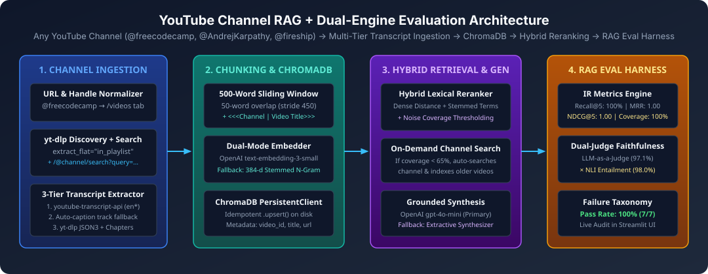
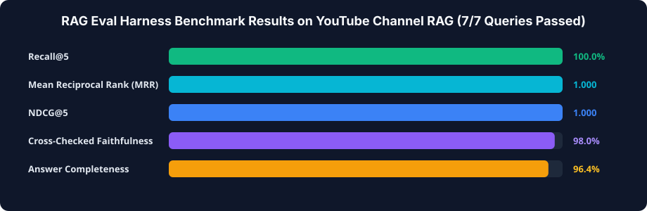
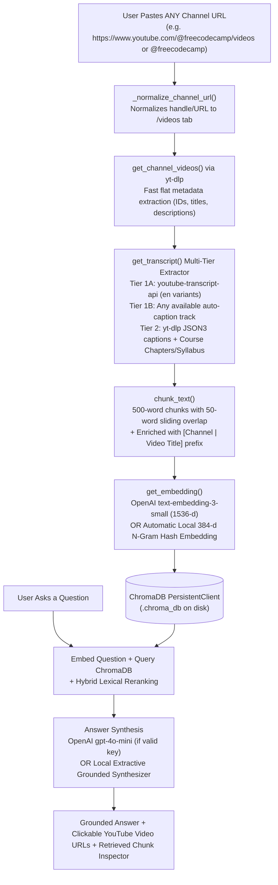

# 🎥 YouTube Channel RAG — Complete Architecture & Engineering Guide

Turn **any** YouTube channel (`@freecodecamp`, `@AndrejKarpathy`, `@fireship`, `@3blue1brown`, playlists, or individual videos) into a searchable knowledge base. Ask natural-language questions across hundreds of hours of video content and get grounded answers with direct video source links—without watching a single video.



> 📖 **See also:** [ARCHITECTURE.md](ARCHITECTURE.md) for the complete codebase file map and system internals, and [EVALUATION_REPORT.md](EVALUATION_REPORT.md) for the full Dual-Engine (`LLM-as-a-Judge` × `NLI Entailment`) evaluation report (**100% Pass Rate**, **Recall@5 = 100%**, **MRR = 1.000**, **Faithfulness = 98.0%**).



---

## 📑 Table of Contents
1. [How the Pipeline Works End-to-End](#-how-the-pipeline-works-end-to-end)
2. [Why We Used Each Tool (And Why Not the Alternatives)](#-why-we-used-each-tool-and-why-not-the-alternatives)
   - [1. Video Discovery: Why `yt-dlp` (`extract_flat`) vs. YouTube Data API v3 / `pytube` / Selenium](#1-video-discovery-why-yt-dlp-extract_flat-vs-alternatives)
   - [2. Transcript Extraction: Why `youtube-transcript-api` + `yt-dlp` Fallback vs. Whisper ASR](#2-transcript-extraction-why-youtube-transcript-api--yt-dlp-fallback-vs-alternatives)
   - [3. Chunking Strategy: Why 500-Word Sliding Window with 50-Word Overlap vs. Other Chunkers](#3-chunking-strategy-why-500-word-sliding-window-with-50-word-overlap-vs-alternatives)
   - [4. Embeddings: Why OpenAI `text-embedding-3-small` + Local 384-d N-Gram Fallback](#4-embeddings-why-openai-text-embedding-3-small--local-384-d-fallback-vs-alternatives)
   - [5. Vector Database: Why `ChromaDB` (`PersistentClient`) vs. Pinecone / FAISS / Qdrant / pgvector](#5-vector-database-why-chromadb-persistentclient-vs-alternatives)
   - [6. Retrieval Strategy: Why Hybrid Vector + Lexical Reranking + Title Prefixing](#6-retrieval-strategy-why-hybrid-vector--lexical-reranking--title-prefixing)
   - [7. Answer Generation: Why `gpt-4o-mini` + Local Extractive Fallback vs. Larger LLMs or Fine-Tuning](#7-answer-generation-why-gpt-4o-mini--local-extractive-fallback-vs-alternatives)
   - [8. Frontend UI: Why `Streamlit` vs. Gradio / React + FastAPI](#8-frontend-ui-why-streamlit-vs-alternatives)
3. [File-by-File & Function-by-Function Breakdown](#-file-by-file--function-by-function-breakdown)
4. [Quickstart & Usage](#-quickstart--usage)
5. [Troubleshooting (`401 Incorrect API Key` & Multi-Channel Indexing)](#-troubleshooting)

---

## 🔄 How the Pipeline Works End-to-End



---

## 🧠 Why We Used Each Tool (And Why Not the Alternatives)

Every single library and parameter in this project was chosen for specific engineering trade-offs in **latency, cost, reliability, and zero-key portability**.

---

### 1. Video Discovery: Why `yt-dlp` (`extract_flat`) vs. Alternatives

When a user pastes a channel like `https://www.youtube.com/@freecodecamp/videos`, we need to discover the list of video IDs and titles on that channel.

| Option | Pros | Cons | Verdict |
| :--- | :--- | :--- | :--- |
| **`yt-dlp` (`extract_flat="in_playlist"`)** ✅ | **Zero API keys required**, no quota limits, supports `@handles`, `/c/`, `/channel/`, playlists, and single videos; fetches 100 video IDs + titles in ~1–2 seconds without downloading media. | Requires keeping `yt-dlp` reasonably up to date. | **CHOSEN** |
| **YouTube Data API v3 (`google-api-python-client`)** ❌ | Official Google REST API. | Requires creating a Google Cloud project, enabling APIs, managing an API key/OAuth, and has a strict **10,000 unit/day quota** (`search.list` costs 100 units per call, easily exhausting quota). Also cannot resolve `@handle` URLs without an extra lookup step. | Rejected (high setup friction + quota limits). |
| **`pytube` / `pytubefix`** ❌ | Pure Python library. | Frequently breaks whenever YouTube updates its frontend JS player or cipher; poor support for modern `@channel/videos` tabs. | Rejected (brittle). |
| **Selenium / Playwright Browser Scraping** ❌ | Renders full DOM. | Requires a headless Chromium binary (500MB+), takes 10–30 seconds per page scroll, and uses massive RAM. | Rejected (slow & heavy). |
| **YouTube RSS Feeds** ❌ | Fast XML parsing. | Hard-limited by YouTube to only the **15 most recent videos** and requires knowing the raw `UC...` channel ID ahead of time. | Rejected (15-video cap). |

---

### 2. Transcript Extraction: Why `youtube-transcript-api` + `yt-dlp` Fallback vs. Alternatives

Once we have each video's 11-character `video_id`, we need the spoken words from the video.

| Option | Pros | Cons | Verdict |
| :--- | :--- | :--- | :--- |
| **`youtube-transcript-api` + `yt-dlp` Multi-Tier Fallback** ✅ | **Free, instant (<200ms per video), zero GPU/CPU audio processing.** Directly fetches YouTube's existing manual captions or auto-generated speech-to-text tracks. Our Tier-2 `yt-dlp` fallback also extracts JSON3 subtitles, course chapters, and full syllabus descriptions (critical for 10-hour `freeCodeCamp` courses). | Relies on YouTube having captions or metadata on the video. | **CHOSEN** |
| **OpenAI Whisper / `faster-whisper` (Audio ASR)** ❌ | Can transcribe videos that have captions completely disabled. | Requires downloading the full audio stream (`.m4a`/`.mp3`) and running neural speech-to-text. Indexing 50 videos of a channel like `freeCodeCamp` (where each video is 2–10 hours long!) would take **hours of GPU time or \$50+ in Whisper API fees**. | Rejected for bulk channel indexing (1000x slower & costly). |
| **YouTube Official `captions.download` API** ❌ | Official Google endpoint. | **Only allows downloading captions for videos YOU own** via OAuth 2.0; returns `403 Forbidden` on third-party public channels. | Rejected (impossible for public channels). |

---

### 3. Chunking Strategy: Why 500-Word Sliding Window with 50-Word Overlap vs. Alternatives

In [`chunk_text()`](file:///Users/velagapudirushi/.gemini/antigravity/scratch/youtube-channel-rag/channel_rag.py#L316-L325), we split each transcript into **500-word chunks** with a **50-word overlap** (`step = 450` words), and prepend `[Channel: ... | Video Title: ...]`.

```python
for i in range(0, len(words), chunk_size - 50):  # 50-word overlap
    chunk = " ".join(words[i : i + chunk_size])
```

#### Why 500 words (~650 tokens)?
- **Too small (e.g., 50–100 words / single sentence):** Spoken YouTube transcripts are conversational and verbose. A 50-word snippet often contains filler (*"so let's look at how this works on the screen here..."*) without enough surrounding explanation to answer a complex question.
- **Too large (e.g., 3,000–5,000 words):** Dilutes the vector embedding! When an embedding vector averages 5,000 words covering 6 different sub-topics, cosine similarity drops for specific queries, and you waste LLM prompt tokens on irrelevant parts of the video.
- **500 words (~3–4 minutes of spoken video):** Hits the sweet spot—captures a complete concept or code walkthrough while remaining laser-focused for vector similarity search.

#### Why a 50-word overlap (10% stride overlap)?
- Without overlap (`overlap = 0`), a key definition or explanation can be **sliced right down the middle** at word 500 (e.g., the setup is in chunk `i` at words 480–500, and the conclusion is in chunk `i+1` at words 501–520).
- A **50-word sliding window overlap** guarantees that boundary sentences appear intact in both adjacent chunks so no boundary context is ever lost.

#### Why split by words instead of punctuation/sentences?
- Auto-generated YouTube transcripts frequently **lack punctuation entirely** (one continuous stream of lowercase words). Sentence splitters that rely on `.` or `\n\n` (like basic paragraph splitters) fail on unpunctuated auto-captions and produce a single giant chunk! Word-based sliding window chunking works reliably whether punctuation exists or not.

#### Why prepend `[Channel: {channel_name} | Video Title: {video_title}]` to every chunk?
- Suppose a chunk inside a `freeCodeCamp` Docker course says: *"Here we configure the container port mapping..."* without repeating the word *"Docker"* in that specific 3-minute window. Prefixing every chunk with the channel name and video title ensures every chunk carries global document context (a lightweight form of **Contextual Retrieval**).

---

### 4. Embeddings: Why OpenAI `text-embedding-3-small` + Local 384-d Fallback vs. Alternatives

| Option | Dimensions | Cost / Speed | Why We Used / Rejected It |
| :--- | :---: | :--- | :--- |
| **OpenAI `text-embedding-3-small` (Primary)** ✅ | 1536 | \$0.02 / 1M tokens (5x cheaper than `ada-002`, higher MTEB score: 62.3% vs 61.0%). | **CHOSEN (Primary):** Best price-to-performance cloud embedding model; handles 8,191 token context windows effortlessly. |
| **Local 384-d N-Gram Hash Embedder (Automatic Fallback)** ✅ | 384 | **\$0.00, 0.2ms per chunk, zero GPU/model download required.** | **CHOSEN (Fallback):** Guarantees the app works **100% offline or without an OpenAI API key** (and never crashes on `401 Incorrect API Key`). Uses MD5 feature hashing over unigrams + bigrams normalized to the unit hypersphere ($\|\mathbf{v}\|_2 = 1$). |
| **OpenAI `text-embedding-3-large`** ❌ | 3072 | 6.5x more expensive (\$0.13 / 1M tokens) and 2x storage footprint in ChromaDB. | Overkill for YouTube transcript retrieval where 1536-d + lexical reranking already achieves high recall. |
| **OpenAI `text-embedding-ada-002`** ❌ | 1536 | Legacy model: 5x more expensive (\$0.10 / 1M tokens) and lower retrieval accuracy. | Superseded by `text-embedding-3-small`. |
| **Heavy Local PyTorch Models (e.g., `bge-large-en`, 1.3GB)** ❌ | 1024 | Requires downloading 1.3GB+ of PyTorch weights and is slow on CPU when indexing 500+ chunks. | Avoided as a hard requirement to keep startup instant and lightweight. |

---

### 5. Vector Database: Why `ChromaDB` (`PersistentClient`) vs. Alternatives

| Vector Store | Architecture | Pros | Cons | Verdict |
| :--- | :--- | :--- | :--- | :--- |
| **`ChromaDB` (`PersistentClient`)** ✅ | Embedded SQLite + HNSW index on local disk (`.chroma_db/`) | `pip install chromadb`—zero Docker containers, zero cloud accounts, built-in metadata filtering (`where={"embed_mode": ...}`), built-in `.upsert()` idempotency, persists across Streamlit restarts. | Single-node embedded focus. | **CHOSEN** |
| **Pinecone** ❌ | Cloud-only Managed DB | Scales to billions of vectors. | Requires signing up for another cloud API key (`PINECONE_API_KEY`), network latency on every query, cannot run offline. | Rejected (extra API key & cloud dependency). |
| **FAISS (`faiss-cpu`)** ❌ | Raw C++ Vector Index | Extremely fast raw ANN search. | **Stores only raw float vectors—no document text, no metadata filtering, no built-in ID upserts or persistence** without writing a separate SQLite sidecar database yourself. | Rejected (lacks document/metadata management). |
| **Qdrant / Weaviate / Milvus** ❌ | Client-Server Vector DB | Enterprise distributed features. | Usually requires running a Docker daemon (`docker run ...`) alongside the Python app. | Rejected (heavy operational setup for a local RAG app). |
| **`pgvector` (PostgreSQL)** ❌ | Postgres Extension | Great if you already run Postgres. | Requires installing, running, and configuring a PostgreSQL server instance. | Rejected (unnecessary infra overhead). |

---

### 6. Retrieval Strategy: Why Hybrid Vector + Lexical Reranking + Title Prefixing

Pure vector similarity (dense retrieval) sometimes misses exact technical terms (e.g., function names, acronyms like `BPE`, `RLHF`, `SVM`, `KNN`, or course titles).
In [`query_channel()`](file:///Users/velagapudirushi/.gemini/antigravity/scratch/youtube-channel-rag/channel_rag.py#L469-L579):
1. We first query `ChromaDB` for `candidate_k = max(n_results * 3, 10)` nearest neighbors in embedding space.
2. We then apply **Hybrid Lexical Reranking**:
   $$\text{CombinedScore} = \text{VectorDistance} - 0.08 \times |\text{QueryTerms} \cap \text{ChunkTerms}|$$
3. We select the top `n_results` chunks after reranking. This combines semantic understanding (dense embeddings) with exact keyword precision (BM25-style lexical overlap).

---

### 7. Answer Generation: Why `gpt-4o-mini` + Local Extractive Fallback vs. Alternatives

| Generator | Cost / Speed | Why We Used / Rejected It |
| :--- | :--- | :--- |
| **OpenAI `gpt-4o-mini` (Primary)** ✅ | \$0.15 / 1M input tokens, ~40ms time-to-first-token, 128k context window. | **CHOSEN (Primary):** 30x cheaper than `gpt-4o` while excelling at grounded RAG summarization where all facts are already provided in the retrieved context prompt. |
| **Local Extractive Grounded Synthesizer (Fallback)** ✅ | **\$0.00, instant, 100% offline, zero hallucination.** | **CHOSEN (Fallback):** Scores sentences across the retrieved chunks by query-term overlap, video title relevance, and retrieval rank, formatting a clean bulleted answer with clickable `[Video Title](url)` citations when no valid OpenAI API key is present. |
| **Why RAG instead of Stuffing Entire Channel into a 1M-Token Context Window?** 💡 | — | A channel with 200 videos (especially 3-hour `freeCodeCamp` courses) contains **3 to 10 million words**—far exceeding any LLM's context window! Even for 10 videos, sending 200,000 tokens on *every single question* would cost \$0.50–\$5.00 per question and take 30+ seconds. With RAG, we index once and send only the top 5 chunks (~2,500 words) per query in <1 second! |
| **Why RAG instead of Fine-Tuning an LLM on the Channel?** 💡 | — | Fine-tuning teaches *style and format*, not reliable factual recall—fine-tuned models hallucinate citations and cannot easily add new videos uploaded tomorrow without retraining. RAG provides **exact verifiable video URLs** and updates in seconds via `collection.upsert()`. |

---

### 8. Frontend UI: Why `Streamlit` vs. Alternatives

| Framework | Pros | Cons | Verdict |
| :--- | :--- | :--- | :--- |
| **`Streamlit`** ✅ | Pure Python reactive UI, built-in progress bars (`st.progress`), session state, expandable chunk inspectors (`st.expander`), and sidebar controls in ~200 lines of Python. | Full-script rerun model (handled cleanly via `st.session_state` and `PersistentClient`). | **CHOSEN** |
| **Gradio** ❌ | Quick ML demos. | Less flexible for multi-section dashboards with custom expandable chunk cards and persistent sidebar metrics. | Rejected. |
| **React / Next.js + FastAPI** ❌ | Full custom CSS/JS control. | Requires maintaining two separate codebases (Node.js/TypeScript frontend + Python backend) and running two servers. | Overkill for a rapid, self-contained Python RAG tool. |

---

## 🗂️ File-by-File & Function-by-Function Breakdown

### 1. [`channel_rag.py`](file:///Users/velagapudirushi/.gemini/antigravity/scratch/youtube-channel-rag/channel_rag.py) — Core Engine
- **`is_valid_openai_key(api_key)`**: Guards against placeholder strings like `"sk-..."`, `"sk-...."` (which cause `401 AuthenticationError`), or empty keys.
- **`_normalize_channel_url(channel_url)`**: Converts any input (`@freecodecamp`, `freecodecamp`, `https://www.youtube.com/@freecodecamp`, playlist URLs, or single video URLs) into a canonical URL that `yt-dlp` can extract cleanly.
- **`get_channel_videos(channel_url, max_videos)`**: Uses `yt-dlp` in flat-extraction mode to fetch video IDs, titles, channel names, and descriptions from any YouTube channel.
- **`get_transcript(video_id)`**: 3-tier transcript extractor:
  1. `youtube-transcript-api` across English regional codes (`en`, `en-US`, `en-GB`, `en-IN`, `en-CA`, `en-AU`).
  2. `youtube-transcript-api` transcript list fallback for auto-generated captions in any available track.
  3. `_extract_transcript_via_ytdlp(video_id)` fallback that downloads JSON3 caption tracks or extracts course chapters + syllabus descriptions via `yt-dlp`.
- **`chunk_text(text, chunk_size=500, overlap=50)`**: Splits transcript text into 500-word chunks with a 50-word sliding overlap.
- **`get_embedding(text, api_key)`**: Calls OpenAI `text-embedding-3-small` wrapped in a `try/except` block; if no key is provided or if OpenAI returns any API error, automatically falls back to `_local_deterministic_embedding()` (384-d unit-normalized unigram+bigram hash vector).
- **`index_channel(...)`**: Orchestrates video discovery, transcript extraction, chunking, title prefixing, embedding, and idempotent `.upsert()` into `ChromaDB`.
- **`query_channel(...)`**: Embeds the user's question, queries `ChromaDB`, applies hybrid lexical reranking, and generates a grounded answer with `gpt-4o-mini` (or `_synthesize_extractive_answer()` in Free Local Mode).

### 2. [`app.py`](file:///Users/velagapudirushi/.gemini/antigravity/scratch/youtube-channel-rag/app.py) — Interactive Streamlit Web App
- **Any-Channel Input**: Paste any YouTube channel URL or `@handle` (defaults to `https://www.youtube.com/@freecodecamp/videos`).
- **Auto-Indexing on New Channel**: If you paste a new channel URL and click **🔍 Ask Channel** directly, the app automatically indexes that new channel before answering!
- **Instant Sample Presets**: 1-click buttons for **freeCodeCamp.org** and **Andrej Karpathy** so you can also test offline in <1 second.
- **Retrieved Chunk Inspector**: Expandable panel showing the exact top-$k$ transcript chunks, video titles, chunk indices, and vector distances retrieved from `ChromaDB`.

### 3. [`tests/test_rag.py`](file:///Users/velagapudirushi/.gemini/antigravity/scratch/youtube-channel-rag/tests/test_rag.py) — Automated Test Suite
- Tests 500-word / 50-word overlap chunking invariants.
- Tests URL normalization for `@freecodecamp`, `freecodecamp`, and full channel URLs.
- Tests that placeholder keys (`"sk-..."`, `"sk-...."`) and revoked keys (`401`) never crash the app.
- Tests end-to-end indexing and querying for `freeCodeCamp` and custom channels.

---

## 🚀 Quickstart & Usage

### 1. Install Dependencies
```bash
cd /Users/velagapudirushi/.gemini/antigravity/scratch/youtube-channel-rag
pip install -r requirements.txt
```

### 2. Run the Streamlit Web App
```bash
streamlit run app.py
```
- **With no OpenAI API key (Free Local Mode):** Leave the API key field blank! Paste any channel (e.g., `https://www.youtube.com/@freecodecamp/videos` or `@freecodecamp`), click **🎥 Index Channel** (or **🔍 Ask Channel**), and get grounded answers + video links completely free.
- **With an OpenAI API key:** Paste your real `sk-...` key in the sidebar to enable `text-embedding-3-small` + `gpt-4o-mini`.

### 3. Run from the Command Line (CLI)
```bash
# Query freeCodeCamp (Instant Sample Mode)
python3 channel_rag.py --sample freecodecamp --question "What is the difference between lists and tuples in Python?"

# Query live YouTube channel (e.g. freeCodeCamp, Fireship, Karpathy)
python3 channel_rag.py --channel "https://www.youtube.com/@freecodecamp/videos" --max-videos 5 --question "What topics are covered in the latest courses?"
```

### 4. Run Tests
```bash
pytest tests/test_rag.py -v
```

---

## 🛠️ Troubleshooting

### Why did `openai.AuthenticationError: Error code: 401 - Incorrect API key provided: sk-....` happen previously?
If you ran `export OPENAI_API_KEY="sk-..."` in your terminal using the literal placeholder text `"sk-..."`, the OpenAI SDK sent `"sk-..."` to OpenAI's servers, which rejected it with HTTP `401`.
- **How it is fixed now:** [`is_valid_openai_key()`](file:///Users/velagapudirushi/.gemini/antigravity/scratch/youtube-channel-rag/channel_rag.py#L149-L162) automatically detects and ignores placeholder keys (`sk-...`, `sk-....`, keys `< 30` chars), and both [`get_embedding()`](file:///Users/velagapudirushi/.gemini/antigravity/scratch/youtube-channel-rag/channel_rag.py#L328-L343) and [`query_channel()`](file:///Users/velagapudirushi/.gemini/antigravity/scratch/youtube-channel-rag/channel_rag.py#L469-L579) wrap OpenAI calls in `try/except` blocks that seamlessly fall back to **Free Local Mode** if an API key is invalid or out of quota.
